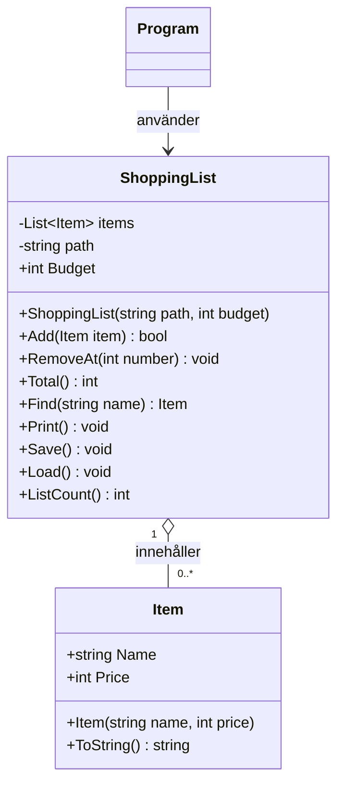

### BudgettTak

Budgettaket på 1000 kr ligger i `ShoppingList`. Taket skickas in i konstruktorn (`new ShoppingList("items.txt", 1000)`) och sparas i `Budget`. `Add` kollar om totalsumman plus den nya varans pris går över budgeten. Om den inte gör det läggs varan till och `Add` returnerar `true`, och om den gör det läggs varan inte till och `Add` returnerar `false`. Program.cs kollar svaret med en `if` och säger till användaren att varan skulle öka totalsumman över budgeten.

Jag valde att `Add` returnerar `false` i stället för att kasta ett undantag eftersom det inte är ett fel att en vara inte får plats i budgeten. Det är ett vanligt svar som kan hända varje gång man handlar, och programmet vet precis vad det ska göra då. Undantag passar bättre när något har gått fel som anroparen inte kan förutse, t.ex. en ogiltig vara eller en fil som inte går att skriva till. Med en `bool` syns det också direkt på metoden att anroparen måste kolla svaret, och koden i Program.cs blir en enkel `if` i stället för en `try`/`catch`.

### Felrapport

1. Items.txt
    * Hadde en tom linje vilket krashade programmet vid load:ens text.Split('\n') vilket gjorde att part[1] inte hadde något att ärva och krashade. Samma krasch kunde hända för alla trasiga rader, t.ex. en rad utan ';' eller med text i stället för ett pris.
    * Först löste jag det genom att ta bort den tomma raden i items.txt, men det fixade inte koden. Nu är det fixat i Load: tomma rader skippas, en rad måste ha exakt två delar och ett pris som går att läsa med int.TryParse, och om Item kastar ett undantag (tomt namn eller negativt pris) fångas det. Trasiga rader skippas och programmet säger hur många som skippades.

2. ShoppingList.Load()
    * ShoppingList.Load() splitade linjer på '\n' men laddade in en fil som använde '\r\n' vilket lämnade '\r' som skapade "gömda" linje splitare som gjorde writeline() mindre läsbart och lästes in på save() funktionen och skapade flera tomma linjer i filen.
    * Blev fixat genom att byta ut File.WriteAllText till en File.WriteAllLines vilket inte behöver antingen '\r\n' eller en text.Split('\n') och med in part[1].Trim() vilket tog bort några '\r' som kan ha lämnats kvar utav förgående kod.

3. ShoppingList.Total()
    * ShoppingList.Total() for loopen började med int i = 1 vilket skippade den första produkten i listan.
    * Blev fixat med att byta ut 1 med 0.

4. int.parce
    * Program.cs använde flera int.parce viket hadde kunnat krashat programmet om man gav fel typ t.ex en string när den frågar efter ett nummer.
    * Blev fixat genom att göra om dem till en while loop med en int.tryparce med en consonle.readline i dem.

5. ShoppingList.RemoveAt()
    * Använde också int.parce men denna krashade även med en int.trypace om man skrev ett nummer som inte fanns. T.ex 0 eller 6 om listan var 5 lång.
    * Fixade det genom att lägga till en minimum på 1 och ett maximum beroende på listans längd på inmatningen.

6. ShoppingList.Save()
    * Hadde en tom catch runt skrivningen till filen. Om skrivningen misslyckades, t.ex. för att filen var öppen i ett annat program eller var skrivskyddad, gömdes felet och programmet skrev ändå "Listan är sparad." fast ingenting sparades.
    * Först tog jag bort catchen helt, men då krashade programmet i stället med ett ohanterat undantag. Nu fångar Save IOException (filen används av ett annat program) och UnauthorizedAccessException (ingen behörighet eller skrivskyddad fil) och säger till användaren att det inte gick att spara.

7. Krash om items.txt inte finns
    * Programmet krashade om filen inte fanns pga Shoppinglist.load använder sig av filen för att ladda alla sparade varor i text filen.
    * Skapade en if i början utav Program.cs som kollar om filen existerar och om den inte gör det skapar den en tom items.txt fil.

8. Inmatning utav ';' i namn
    * Om man matade in ett namn på en vara med ett namn som innehåller ';' hade ; och det efter den blevit helt ignoerat utav programmet men fortfarande blevit sparad in i items.txt men hade inte krashat programmet.
    * La till en while loop som kollade om namnet på varan innehåller ';' och om namnet gör det behöver man göra en ny inmatning tills namnet inte innehåller tecknet ';'.

### Klassdiagram

- `+` betyder public och `-` betyder private.
- `Program` använder en `ShoppingList`, som innehåller noll eller flera `Item`.
